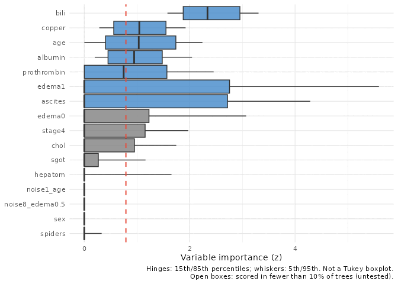
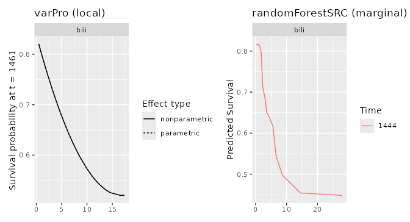
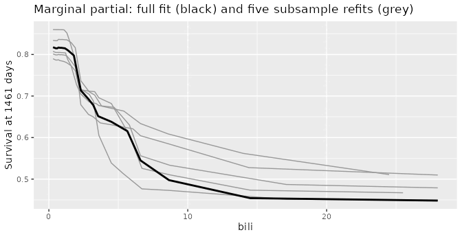

# varPro on small or sparse data

``` r

library(ggplot2)
if (requireNamespace("ggRandomForests", quietly = TRUE)) {
  library(ggRandomForests)
} else if (requireNamespace("pkgload", quietly = TRUE)) {
  pkgload::load_all(export_all = FALSE, helpers = FALSE,
                    attach_testthat = FALSE)
} else {
  stop("Install ggRandomForests (or pkgload for dev builds) to render this vignette.")
}
```

varPro ([Lu and Ishwaran 2024](#ref-Lu2024varpro)) ranks variables by
releasing the rules of a random forest one variable at a time and asking
how much the outcome moves. Its defaults suit a large data set, where
every candidate variable gets many chances to be tested. On a small one,
or one with many rare factor levels, some candidates are barely tested
at all, and the output does not tell you which. This vignette shows how
to find out, how much the defaults matter, and what the partial plots
can and cannot say when the sample is small.

Most of the behaviours described here belong to varPro and
randomForestSRC; for those we name the upstream function and the
argument that changes it. Where a behaviour is ggRandomForests’ own, we
say so.

## The data

We use the primary biliary cirrhosis data from `randomForestSRC`: the
276 complete cases, 111 deaths, and 17 predictors, with the yes/no and
graded predictors stored as factors. To give the screen something it
should reject, we add ten permuted copies of real columns: the same
values shuffled between patients, so unrelated to survival by
construction. Five copy continuous predictors and five copy factors, so
each kind of variable has noise of its own kind. The fits are in
`vignettes/precompute_varpro_small.R`. The two that matter are a varPro
fit on its defaults and one with every variable offered to the forest:

``` r

library(survival)
vp_guided <- varPro::varpro(Surv(days, status) ~ ., data = d, ntree = 1000)
vp_open   <- varPro::varpro(Surv(days, status) ~ ., data = d, ntree = 1000,
                            split.weight = FALSE, mtry = 4)
```

## Which variables did varPro test?

A variable can drop out at three places, and it helps to name them.

- **Eligible.** varPro first ranks the candidates quickly, by default
  with a lasso and a shallow forest (“split weights”), and builds
  release rules only for the top of that ranking (`nvar`). A factor
  enters as one term per level. A term below that cut is *not eligible*:
  no rule is ever built for it, so the screen says nothing about it, for
  or against.
- **Tested.** An eligible term is scored tree by tree, by comparing the
  outcome inside a rule with the outcome once the rule’s condition on
  that term is released. A term scored in at least 10% of the trees we
  call *tested*.
- **Untested.** Everything else: terms that were not eligible, eligible
  terms with no usable rule, and terms scored in too few trees.

[`varpro_coverage()`](https://ehrlinger.github.io/ggRandomForests/reference/varpro_coverage.md)
reports all three, per term or, with `by = "variable"`, per variable
with factor levels rolled up. For the fit on varPro’s defaults:

``` r

cg_real[, c("variable", "eligible", "n_trees", "coverage", "z", "tested")]
```

          variable eligible n_trees coverage          z tested
    1         bili     TRUE    1000    1.000 2.38730155   TRUE
    2       copper     TRUE     988    0.988 1.04780906   TRUE
    3      albumin     TRUE     982    0.982 0.97009864   TRUE
    4          age     TRUE     950    0.950 1.06184713   TRUE
    5  prothrombin     TRUE     844    0.844 0.79292410   TRUE
    6        edema     TRUE     585    0.585 0.92774489   TRUE
    7      ascites     TRUE     398    0.398 0.86660689   TRUE
    8         chol     TRUE     394    0.394 0.28871954   TRUE
    9        stage     TRUE     318    0.318 0.33882610   TRUE
    10        sgot     TRUE     188    0.188 0.09401103   TRUE
    11     hepatom     TRUE     131    0.131 0.07500533   TRUE
    12     spiders     TRUE      59    0.059 0.00000000  FALSE
    13         sex     TRUE      12    0.012 0.00000000  FALSE
    16         alk     TRUE       0    0.000         NA  FALSE
    17        trig     TRUE       0    0.000         NA  FALSE
    18    platelet     TRUE       0    0.000         NA  FALSE
    23   treatment    FALSE       0    0.000         NA  FALSE

Of 17 predictors, 1 was not eligible (treatment), 3 were eligible but
never got a usable rule (alk, trig, platelet), and 2 were returned but
scored in too few trees to rank (spiders in 5.9% of trees; sex in 1.2%
of trees). That is 6 of 17 predictors about which the screen has no
evidence either way.

## What does a z of zero mean?

varPro’s importance (z) is an average over the trees, and a tree with no
rule for the term counts as zero. The average is winsorised: trees above
the 90th percentile are pulled down to it and trees below the 10th
pulled up, before averaging (`trim = 0.1` in
[`varPro::importance()`](https://www.randomforestsrc.org/reference/importance.html)).
Nothing is dropped; the clamping stops a few extreme trees from
dominating.

The side effect is the one to know about. For a term scored in fewer
than one tree in ten, the 90th percentile is itself zero, so every
non-zero tree is pulled down to zero and z comes back as exactly 0,
whatever those trees found. The reverse does not hold: a term scored in
every tree also gets z = 0 when the outcome means its rules compare
agree. **A z of 0 is ambiguous, and coverage tells the two apart:** with
low coverage it means “not tested enough to rank”, with high coverage
“tested and found unimportant”. Read coverage beside z, never z alone.

## Reading the importance plot

[`gg_varpro()`](https://ehrlinger.github.io/ggRandomForests/reference/gg_varpro.md)
draws each term’s importance across the trees. Score all the trees: by
default
[`varPro::importance()`](https://www.randomforestsrc.org/reference/importance.html),
and
[`gg_varpro()`](https://ehrlinger.github.io/ggRandomForests/reference/gg_varpro.md)
with it, scores a random sample of 150, so the answer can change from
run to run. Here the default sample selects 6 terms and scoring all
1,000 trees selects 7.

``` r

plot(vs$gg_guided_all)
```



``` r

# Live: plot(gg_varpro(vp_guided, max.tree = vp_guided$rf$ntree))
```

Three things are easy to misread.

- **Untested trees add zeros.** Each tree that never tested a term
  contributes a 0, which pulls the lower whisker and box toward 0 as
  coverage falls. At high coverage the box reflects the scored trees,
  and need not reach 0.
- **Order and colour measure different things.** Rows are ordered by the
  median tree, but coloured by z, the winsorised mean, against the
  cutoff (dashed). A term that a few trees find very important and many
  find unimportant has a long box and a low median; it can rank below a
  term with steadier, smaller importance.
- **A row with no box** is a term scored in too few trees; its z is 0
  for the reason above, and the caption calls these open boxes.

## How much do the settings matter?

Two settings turn the per-tree scores into a ranking and a selection:
the winsorising `trim`, and the `cutoff` (0.79 by default) that colours
a term as selected. We rescored the same fit with less winsorising.

``` r

trim_tab <- data.frame(
  trim = names(vs$trim_z),
  terms_above_0 = vapply(vs$trim_z, function(t) sum(t$z > 0), integer(1)),
  terms_above_0.79 = vapply(vs$trim_z, function(t) sum(t$z > 0.79), integer(1)),
  rank_agreement = vapply(vs$trim_z, function(t) {
    b <- vs$trim_z[[1]]
    round(stats::cor(t$z, b$z[match(t$term, b$term)], method = "spearman"), 2)
  }, numeric(1)))
trim_tab
```

           trim terms_above_0 terms_above_0.79 rank_agreement
    0.1     0.1            12                7           1.00
    0.05   0.05            13                7           0.97
    0.025 0.025            13                7           0.97
    0         0            16                7           0.97

The trim matters little: the ranking holds, and the terms that gain a z
above zero are the barely tested ones, at values close to zero. The
cutoff matters a great deal. Here is how many variables each cutoff
keeps.

``` r

vz <- cg_real[!is.na(cg_real$z), ]
cuts <- c(0, 0.5, 0.7, 0.79, 0.9, 1, 1.5)
data.frame(cutoff = cuts,
           variables_kept = vapply(cuts, function(k) sum(vz$z > k), integer(1)))
```

      cutoff variables_kept
    1   0.00             11
    2   0.50              7
    3   0.70              7
    4   0.79              7
    5   0.90              5
    6   1.00              3
    7   1.50              1

``` r

band <- vz[vz$z > 0.5 & vz$z <= 1, ]
band[order(-band$z), c("variable", "z", "coverage")]
```

         variable         z coverage
    3     albumin 0.9700986    0.982
    6       edema 0.9277449    0.585
    7     ascites 0.8666069    0.398
    5 prothrombin 0.7929241    0.844

4 well-tested variables sit between z 0.5 and 1.0, one of them
(prothrombin, z 0.79) right on the default line. Anywhere in that range
the “selected” set runs from 3 to 7 variables. varPro’s own
cross-validation,
[`varPro::cv.varpro()`](https://www.randomforestsrc.org/reference/cv.varpro.html),
chooses a cutoff of 0.72 for this fit. With varPro’s default
standardisation z also shrinks as more terms share each tree, so a
cutoff does not carry from one fit to another. If you need a selection,
tune the cutoff; do not take 0.79 as given.

## Checking against noise

The noise columns give a reference that moves with the fit.
`varpro_coverage(noise = "^noise")` marks them, takes the largest z
among the *tested* noise copies of each kind (categorical or
continuous), and flags a real variable as `selected` when it beats that
bar.

On varPro’s defaults the check is empty: the split weights kept every
noise copy out (0 of 10 tested), which is a useful filter but leaves
nothing to compare against, and
[`varpro_coverage()`](https://ehrlinger.github.io/ggRandomForests/reference/varpro_coverage.md)
warns about it. With every variable offered (`split.weight = FALSE`),
the noise is tested:

``` r

co_noise <- co[co$noise, ]
data.frame(kind = c("continuous", "categorical"),
           noise_tested = c(sum(co_noise$tested & co_noise$kind == "continuous"),
                            sum(co_noise$tested & co_noise$kind == "categorical")),
           largest_noise_z = c(max(co_noise$z[co_noise$kind == "continuous"], na.rm = TRUE),
                               max(co_noise$z[co_noise$kind == "categorical"], na.rm = TRUE)))
```

             kind noise_tested largest_noise_z
    1  continuous            5       0.3978672
    2 categorical            5       0.1515197

Continuous noise scores higher than categorical noise with no relation
to the outcome at all. A forest favours variables with many split
points, and a permuted continuous column still offers many. That is why
the bar is set per kind. Against it, 15 of the 17 real variables beat
the noise in this one fit: the screen tests everything, but it is not
parsimonious.

## A screen or a selection?

A selection says the kept variables were compared with the rest and
found to matter. One varPro fit on its defaults keeps everything it
returns, including variables it never tested, with no comparison against
noise and no check of its stability. That makes it a *screen*: it
narrows the candidates to a list a model can use, and it does not
establish which variables matter.

If you need a selection, each step above is a lever:

- offer every variable (`split.weight = FALSE`), so each one is tested;
- report coverage beside z
  ([`varpro_coverage()`](https://ehrlinger.github.io/ggRandomForests/reference/varpro_coverage.md)),
  and score all trees (`max.tree = ntree`);
- set the cutoff by cross-validation
  ([`varPro::cv.varpro()`](https://www.randomforestsrc.org/reference/cv.varpro.html))
  or by noise copies of each kind, not by the default;
- refit on subsamples and keep the variables selected in most of them;
- and, if the selected variables feed a model you then evaluate, do the
  selection inside the cross-validation, so the model is not judged on
  the data that chose its variables.

## Partial dependence on small data

[`gg_partial_varpro()`](https://ehrlinger.github.io/ggRandomForests/reference/gg_partial_varpro.md)
shows how the prediction moves with one variable *locally*: it samples
training cases at random, makes virtual twins of each by setting the
variable to a grid of values with the rest of the case held as it is,
and keeps only the twins that resemble the training data (an
isolation-forest filter by default).
[`gg_partial_rfsrc()`](https://ehrlinger.github.io/ggRandomForests/reference/gg_partial_rfsrc.md)
shows it *marginally*: the variable is set to each value for every case
and the predictions averaged. Here is bilirubin both ways, survival at
1461 days:

``` r

one_var <- function(p, v) {
  p$continuous <- p$continuous[p$continuous$name == v, , drop = FALSE]
  p$categorical <- p$categorical[0, , drop = FALSE]
  p
}
patchwork::wrap_plots(
  plot(one_var(vs$pd_local, "bili")) + labs(title = "varPro (local)"),
  plot(one_var(vs$pd_marginal, "bili")) + labs(title = "randomForestSRC (marginal)"),
  nrow = 1)
```



The two panels come from different forests: the varPro fit above
(one-hot factors, the noise columns, guided splits) and a plain
[`rfsrc()`](https://www.randomforestsrc.org//reference/rfsrc.html) fit
on the 17 real predictors, which is how the two are usually produced.
Agreement is reassuring. A difference can come from the methods (the
local profile drops unsupported twins, so the marginal curve may be
extrapolating where there are no cases) or simply from the two forests;
to separate those, pass the varPro forest (`vp$rf`) to
[`gg_partial_rfsrc()`](https://ehrlinger.github.io/ggRandomForests/reference/gg_partial_rfsrc.md).
Four things matter more on small data.

**The band is not a confidence interval.** Both plots summarise the
cases of *one* fitted forest. The spread shows how much cases differ,
not how uncertain the curve is; varPro’s is narrower still, because
[`varPro::partialpro()`](https://www.randomforestsrc.org/reference/partialpro.html)
gives every case the same intercept. To see the uncertainty of the
curve, refit on subsamples. Five refits on 63% of the cases move the
marginal bilirubin curve this much:

``` r

refits <- do.call(rbind, lapply(vs$pd_refits, function(p) {
  cbind(p$continuous, refit = factor(p$refit))
}))
full <- vs$pd_marginal$continuous
full <- full[full$name == "bili", ]
ggplot(refits, aes(x, yhat, group = refit)) +
  geom_line(colour = "grey60") +
  geom_line(data = full, aes(x, yhat), inherit.aes = FALSE, linewidth = 1) +
  labs(x = "bili", y = sprintf("Survival at %d days", vs$tau),
       title = "Marginal partial: full fit (black) and five subsample refits (grey)")
```



**Survival horizons snap to event times.** randomForestSRC estimates
survival on the grid of observed event times, so a requested horizon is
moved to an event time. A request for 1461 days returns day 1444. Before
the first event it is silent: requests at days 10, 30 and 41 (the first
death) all return the same curve, at day 41, and a request at day 365
returns day 348. In a small arm with no early events, every early
horizon is the same curve. Check the returned time, and choose horizons
after the first event.

**Factors are partialled level by level.** varPro one-hot encodes a
factor, so `stage` becomes stage1, stage2, stage3, stage4, and
[`gg_partial_varpro()`](https://ehrlinger.github.io/ggRandomForests/reference/gg_partial_varpro.md)
(through
[`varPro::partialpro()`](https://www.randomforestsrc.org/reference/partialpro.html))
looks terms up by those names: ask for `stage` and it is skipped with a
warning. Each level is then partialled on its own, with every case set
to 0 and to 1 on that level:

``` r

ct <- vs$pd_local$categorical
lvl <- c("stage3", "stage4", "edema0", "edema1")
level_median <- function(l, at) {
  median(ct$parametric[ct$name == l & ct$variable == at], na.rm = TRUE)
}
data.frame(level = lvl,
           partial_at_0 = vapply(lvl, level_median, numeric(1), at = 0),
           partial_at_1 = vapply(lvl, level_median, numeric(1), at = 1),
           row.names = NULL)
```

       level partial_at_0 partial_at_1
    1 stage3    0.8861823    0.8881534
    2 stage4    0.8929344    0.8480336
    3 edema0    0.8047510    0.8815061
    4 edema1    0.8931489    0.6818633

Stage 4 and severe edema (`edema1`) lower predicted survival, as the
data say: Kaplan-Meier survival at 1461 days is 0.54 for stage 4 against
0.87 for the other stages. Before ggRandomForests PR \#350 (in releases
up to 4.0.0-rc9), these columns could be labelled in the wrong order,
swapping “0” and “1”; refit any factor partials made with an earlier
build.

One caveat remains, and it is varPro’s. `partialpro()` sets the one
level column and leaves the factor’s other level columns as they were,
so a stage 3 case “set to stage4 = 1” is stage 3 and stage 4 at once, a
case that cannot exist. Here it matters little: the forest’s mean
predicted survival for stage 4 is 0.717 with the other level columns
left alone and 0.714 with the whole factor set to stage 4. On other data
it could matter more;
[`gg_partial_rfsrc()`](https://ehrlinger.github.io/ggRandomForests/reference/gg_partial_rfsrc.md)
sets the factor itself to each level, and is the check.

**Survival partials are clamped to \[0, 1\].**
[`varPro::partialpro()`](https://www.randomforestsrc.org/reference/partialpro.html)
smooths each case without a link function, so on the survival scale a
curve can leave \[0, 1\];
[`gg_partial_varpro()`](https://ehrlinger.github.io/ggRandomForests/reference/gg_partial_varpro.md)
clamps it. On a small arm, a curve sitting on 0 or 1 is a sign of that
clamp, not of certainty.

## References

Lu, M., and H. Ishwaran. 2024. “Model-Independent Variable Selection via
the Rule-Based Variable Priority.” *arXiv Preprint*.
<https://arxiv.org/abs/2409.09003>.
